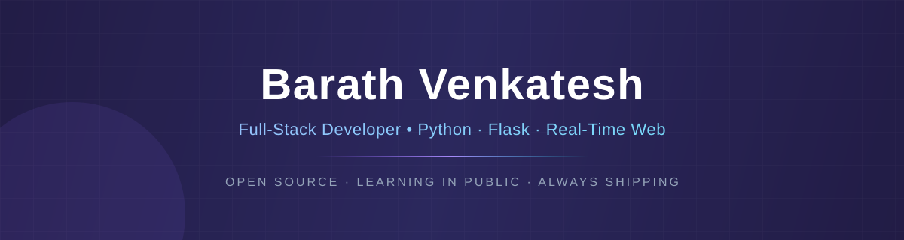
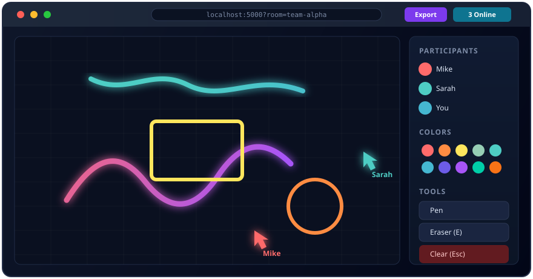
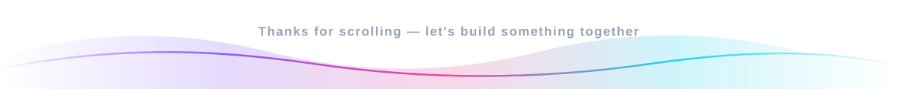

<!--
  ============================================================================
  ✦  PROFESSIONAL GITHUB PROFILE — READ ME FIRST
  ----------------------------------------------------------------------------
  This file renders on https://github.com/Barathvenkatesh
  because the repository MUST be named exactly: Barathvenkatesh/Barathvenkatesh

  Before publishing, run setup/publish.ps1 — it replaces these placeholders:
    Barathvenkatesh   -> your GitHub username
    Barath Venkatesh       -> your display name
    Barathvenkatesh       -> your name without spaces (links / handles)
    Barathvenkatesh@users.noreply.github.com      -> your public email
    India       -> your location
    Barathvenkatesh   -> your LinkedIn slug
    Barathvenkatesh    -> your X / Twitter handle
  ============================================================================
-->

<div align="center">



<br />


<br /><br />

<a href="https://github.com/Barathvenkatesh?tab=followers"></a>


<br /><br />

<a href="#-about-me">About</a> • <a href="#-tech-stack">Stack</a> • <a href="#-featured-projects">Projects</a> • <a href="#-github-stats">Stats</a> • <a href="#-learning-roadmap">Roadmap</a> • <a href="#-connect-with-me">Connect</a>

</div>

<br />

---

## 🧑‍💻 About Me

> **I turn coffee into clean code and ideas into working software.**

I'm **Barath Venkatesh** — a developer who enjoys building things that are both *useful* and *well-crafted*. My sweet spot is the intersection of **Python backends**, **real-time web apps**, and **thoughtful UI**. I started with college lab experiments (prime checkers, loops, conditionals) and quickly realized I liked shipping complete products — so I built a **real-time collaborative whiteboard** with WebSockets and haven't looked back.

Right now I'm focused on growing as a **full-stack developer**, contributing to open source, and documenting everything I learn along the way.

<table>
  <tr>
    <td>🎯 <b>Current focus</b></td>
    <td>Full-stack development · Flask · Socket.IO · Data structures</td>
  </tr>
  <tr>
    <td>📍 <b>Based in</b></td>
    <td>India</td>
  </tr>
  <tr>
    <td>🎓 <b>Journey</b></td>
    <td>Computer Science student → self-taught builder</td>
  </tr>
  <tr>
    <td>⚡ <b>Superpower</b></td>
    <td>Turning a vague idea into a running demo, fast</td>
  </tr>
  <tr>
    <td>🤝 <b>Open to</b></td>
    <td>Hackathons · freelance projects · open-source collaboration</td>
  </tr>
</table>

---

## 🛠️ Tech Stack

<p align="center">
  
  
  
  
  
  
  
  
  
  
  
  
</p>

<p align="center">
  <sub>Always learning. Currently exploring: <b>React</b> · <b>PostgreSQL</b> · <b>Docker</b> · <b>APIs</b></sub>
</p>

---

## 🚀 Featured Projects

### 1. 🎨 Collaborative Whiteboard — *real-time, multi-user drawing*



A hackathon-grade drawing app where multiple people sketch on the **same canvas at the same time**. Drawings, live cursors, and participant presence sync instantly over WebSockets.

| | |
|---|---|
| **What it does** | Shared rooms via URL · live strokes & cursors · 12-color palette · eraser · undo/redo · PNG export · mobile/touch support |
| **Under the hood** | Flask + Flask-Socket.IO, Canvas API, MD5-based user colors, per-room drawing history, responsive dark UI |
| **Why it matters** | Real-time sync is genuinely tricky — this proves I can handle state, events, and polish in one product |
| **Run it locally** | `pip install flask flask-socketio` → `python server.py` → open `http://localhost:5000?room=demo&name=You` |

<a href="https://github.com/Barathvenkatesh/collaborative-whiteboard"></a>

<br />

### 2. 🔢 Prime Number Checker — *where the journey started*

My **College Experiment #2**: a clean, input-validated Python script that checks whether an integer is prime using trial division up to √n.

```python
def is_prime(n: int) -> bool:
    """Return True if n is prime, False otherwise."""
    if n < 2:
        return False
    if n == 2:
        return True
    if n % 2 == 0:
        return False
    for i in range(3, int(n ** 0.5) + 1, 2):
        if n % i == 0:
            return False
    return True
```

> Small program, big lesson: **correctness first, then optimization** (notice the `√n` bound and skipping even numbers).

<br />

### 3. 🧭 The Project Playground — *20 ideas, one roadmap*

A curated learning backlog spanning CLI tools (temperature converter, to-do list, quiz game), web apps (portfolio, localStorage to-do), SQLite systems, and data science (CSV explorer, weather app, stock tracker).

<a href="https://github.com/Barathvenkatesh"></a>

---

## 📊 GitHub Stats

<div align="center">


<br /><br />


<br /><br />


<sup>My contribution graph, slithering through the year 🐍 — auto-updated daily by GitHub Actions.</sup>

</div>

---

## 🏆 Trophies & Activity

<div align="center">


<br /><br />


</div>

---

## 🗺️ Learning Roadmap

| Phase | What I'm learning | Status |
|:---|:---|:---:|
| 🟢 **Foundations** | Python, logic, loops, functions, file I/O, Git | ✅ Done |
| 🟢 **Web basics** | HTML, CSS, responsive design, JavaScript DOM | ✅ Done |
| 🟡 **Backend** | Flask, REST APIs, WebSockets, SQLite | 🔄 In progress |
| 🟡 **Data** | Pandas, NumPy, Matplotlib, CSV/API work | 🔄 In progress |
| ⚪ **Next up** | React, PostgreSQL, Docker, deployment (CI/CD) | ⏳ Planned |
| ⚪ **Long game** | Open-source contributions, system design, cloud | ⏳ Planned |

> Progress is a habit, not a destination. I commit even on the messy days.

---

## 💬 Currently

- ⚡ Building better tools for **real-time collaboration**
- 📚 Reading about **web architecture** and **clean code**
- 🧪 Experimenting with **GitHub Actions** to automate this very profile
- 🎯 Looking for a **hackathon team / internship** to grow with

---

## 📫 Connect With Me

<div align="center">

<a href="mailto:Barathvenkatesh@users.noreply.github.com"></a>
<a href="https://github.com/Barathvenkatesh"></a>

<br /><br />

<a href="https://github.com/Barathvenkatesh"></a>

</div>

<br />

<div align="center">
  
  <br />
  <sub><i>"The best way to predict the future is to invent it." — Alan Kay</i></sub>
  <br /><br />
  <sub>Built with ❤️, Python, and too much chai. &nbsp;|&nbsp; © 2026 Barath Venkatesh</sub>
</div>
